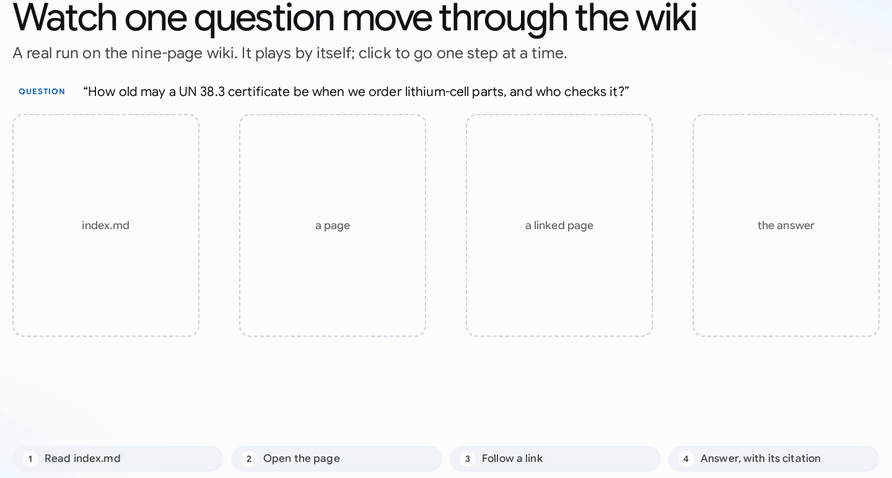

# Section 7 · The LLM Wiki (v5, reworked 6 Nov 2026) · speaker notes

Simpler and more visual, as asked on 6 Nov: start from one real page (the amendment AMD-SUP-2026-02), show the wiki as
the files it is, walk ingest and query one step at a time, then step up to D's six pages. Every file, line and number on
the slides is from a recorded run:
- `experiments/v5_wiki_simple_modal.py` (6 Nov, Modal, gemini-3.8-flash, Google direct): the amendment ingested **alone**
  into an empty wiki by the course's own builder (`wiki_build.build(files=[AMD])`), every call logged
  (`logs/v5_wiki_simple_ingest.json`); and four staff questions read through the nine-page wiki (D, then the amendment)
  by the course's own `wiki_query.Navigator` and the race's answer step (`logs/v5_wiki_simple_query.json`).
- `experiments/v5_wiki_modal.py` (4 Nov): D ingested alone (six pages), then the amendment ingested into it
  (`logs/v5_wiki_ingest.json`, `logs/v5_wiki_update.json`). The full-wiki numbers come from the race (`logs/race.json`)
  and the build (`logs/wiki_build.json`).
- `experiments/v5_wiki_simple_data.py` writes `window.L3V5.wiki.simple` into `v5/wiki_data.js` and checks that every
  highlighted line is an exact substring of the real file. `experiments/v5_wiki_nav_gif_modal.py` renders the GIF.
Film 2 is placed by the lead (between the class question and the check).

What moved out of the slides (say it only if asked): the ingest prompt's five parts (D's READ call: 8,460 tokens in,
about half the same for every source), the reply JSON, the quote check's normalising, AGENTS.md rule by rule, the query's
token bars, lint's 1,073 findings, where the wiki lives (git, a section index, one audience per page). All are in the
4 Nov notes and logs.

## Section 7 (part slide) · What if the model wrote Northbridge's wiki first?
RAG searches the raw text every time a question arrives. Turn it around: let the model read each document once, now, and
write down what it learned as pages. Then questions read the pages.

## The Idea in One Picture
Karpathy's gist, April 2026. Read it after class.
[click] Ingest: the model reads each source once and writes pages. 693 files became 683 pages.
[click] People write one file, AGENTS.md: the rules every ingest follows.
[click] Query: read index.md, open pages, answer; each sentence cites a raw source.
[click] RAG, for contrast: nothing is written in advance; it searches the chunks on every question.
The one thing to keep: the wiki spends its model calls before the question, RAG at the question.

## A Wikipedia Page, Read as a Design
Kept. Nine clicks, one part each: title, lead, infobox, contents, blue links, references, "needs citations", view
history, search. Each has a counterpart in our wiki; we will see most of them in a real file in two slides.

## Start Small: One Page In
The smallest real source in the dump: AMD-SUP-2026-02, one PDF page. It changes one rule of the Supplier Policy: from
1 September 2026 a UN 38.3 certificate counts only if issued in the last 12 months and valid 60 days past the order.
Read it as a careful person first. Ask: what would you write down, and where?
[click] The amendment itself: a page about what changes, from when, and why (§1, §2).
[click] The rule it replaces lives in another document, POL-SUP-003 §4.4. Its page should hold the old rule and the new.
[click] UN 38.3 certificates: many documents talk about them. One topic page that every source adds to.
[click] The senior buyer runs the monthly expiry report (§3.2): a role page.
[click] What the model wrote, reading only this page: 5 pages, 13 facts. Our four, plus `items-bat` for the BAT-* packs
(§3.1, "lithium-cell part"). Every fact carries a quote copied from the page; code found all 13 quotes. That is the
whole idea of ingest: one source, several pages, because a page is about a thing, not about a file.

## The Wiki Is a Folder of Files
The same run, on disk. Nothing magic: plain text files.
Point at the tree: `index.md`, `log.md`, `pages/` (one file per page), `lists/` (pages named by a code, listed),
`restricted/` (the HR-only index, empty here), `facts.jsonl`, `sources.jsonl`, `manifest.json`. 12 files, 5 pages,
1,485 words, 19 links, 13 references.
[click] `index.md`: one line per page, `[[slug]] Title: summary`, grouped by type. Every question reads it first.
[click] `log.md`: one line per ingest (`+5 ~0`: five created, none updated) and one for the index rebuild.
[click] A page. Its first lines are the front matter. Next slide opens it properly.
Students may click any file.

## One Page, Opened
`pages/amd-sup-2026-02.md`, the real file (67 lines). The line numbers are the file's own; a dashed line means lines
were skipped to fit.
[click] Front matter: title, type, slug, summary, audience, sources, dates. Code reads it: index.md is built from the
summaries; audience decides who may open the page.
[click] The lead: what it is, what matters today.
[click] Sections: fixed by the page type in AGENTS.md. For a policy, one `###` per clause, then Versions and conflicts,
See also, References. (The infobox appears twice in this file, once from the renderer and once from the model: a real
slip, harmless.)
[click] Links: `[[pol-sup-003|POL-SUP-003]]`, like a blue link. This is what the reader follows at query time.
[click] Citations: `[^r2]` ends the sentence; References line 61 turns it into the PDF, page 1, §1. Every sentence can be
checked by eye against the source.

## Ingest, Step by Step
Four steps. Two are model calls, two are plain code.
[click] 1, Read: one call gets the instructions with AGENTS.md, the list of page names that already exist, and the whole
page. 6,552 tokens in, 2,443 out, 14.5 s. The list of names is why two sources about one thing land on one page.
[click] 2, Decide: the same reply is JSON: the pages, and facts for each with a quote. Code checks every quote is in the
page: 13 of 13. A small second call (1,143 tokens) checks new names against old ones: nothing merged.
[click] 3, Write: one call per page, five calls side by side, 7.8 s. The writer sees that page's facts with keys, never
the source: so every sentence it writes can cite.
[click] 4, List and log: code rebuilds index.md from the summaries and appends one line to log.md.
[click] In all: 7 calls, 25,846 tokens in, 5,315 out, $0.043, 25.0 s of model steps, for one page. (Parsing and loading
the registry of names took another 38.5 s; not shown.)

## Step Up: D Becomes Six Pages
D, the Purchase Policy from the RAG sections: four pages, nine sections. Same ingest, 8 calls, $0.055.
[click] The policy's own page, `pol-pur-001.md`, takes 22 of the 29 facts, from every section but §1.
[click] The five things D names or mentions get their own pages: the approval matrix (§5), UN 38.3 certificates (§6), the
tax codes (§8), screen FIN-CC-01 (§4), Henrik Weber (the header). The model proposed `topic-tax-codes`; the build's name
check mapped it to `data-tax-codes`. Note: D names POL-SUP-003 (§6.3) but says nothing about it, so no page yet.
[click] index.md for these six: this is all the reader sees first.

## The Amendment Joins D's Wiki
Now the amendment arrives in D's six-page wiki (4 Nov run).
[click] Nine pages: 3 new (`amd-sup-2026-02`, `pol-sup-003`, `role-pur-senior-buyer`), 1 rewritten
(`topic-un-38-3-certificates`), 5 unchanged. 5 calls, 25.0 s, $0.038. `pol-pur-001.md` was not touched: its §6 still has
no link to the amendment. Ask: is that a problem? (It is the "stale" risk.)
[click] The topic page's lead, before and after: the 12-month and 60-day rule is now written in. The before text says
"blocking order creation": remember it for the failure slide.
[click] log.md: one new line, `+3 ~1`.
Note the names: ingested alone, the amendment's role page was `role-pur-sr`; inside D's wiki it is
`role-pur-senior-buyer`. The name depends on what the registry and the model saw; the merge call keeps a wiki
consistent with itself, not across separate builds.

## Query, Step by Step
The animation plays by itself when the slide opens (about 21 s a loop). Click to step: six clicks.
GIF for sharing and the notes: `v5/img/wiki/wiki_nav.gif` (892 × 478, about 60 frames, 21.5 s a loop, 0.75 MB), rendered by `experiments/v5_wiki_nav_gif_modal.py`.

A real run (6 Nov) on the nine-page wiki, question S-4: "How old may a UN 38.3 certificate be when we order lithium-cell
parts, and who checks it?"
[click] Read index.md. Turn 1: 946 tokens in, 2.2 s. The reply opens three pages at once: the UN 38.3 topic, the
amendment, POL-SUP-003. Their index lines light up.
[click] Open the page: `topic-un-38-3-certificates.md`. The 12-month, 60-day rule is in its lead. The two other pages are
the cards behind it.
[click] On that page, a link: `[[role-pur-senior-buyer|senior buyer]]`, next to the monthly expiry report. The question
also asked who checks it. Turn 2 (3,598 tokens, 2.1 s): open that page (and `pol-pur-001`).
[click] Follow the link: `role-pur-senior-buyer.md`, line 26, the monthly report with a 90-day window.
Turn 3 (6,227 tokens, 2.6 s): done.
[click] The answer call: five pages in, 4,226 tokens, 6.8 s. It cites [1] [2] [3] [5]. The orange line: "Ledgerline ERP
automatically enforces order blocking", repeated from the topic page's infobox, which was wrong at ingest (failure 2).
[click] The citation: [5] is the role page, its `[^r1]` is the amendment PDF, page 1, §3, and clause 3.2 says exactly
that. Every hop can be checked.
Total: 3 reader calls (10,771 tokens, 6.8 s of model time) plus the answer call. The other three runs are in the log:
S-1 (18-month-old certificate) opened the amendment and its two linked pages and said no; S-3 (cheaper quote) found
POL-PUR-001 §6.4; S-2 (Emma's Brightcell question) answered "NOT IN THE DOCUMENTS": D and the amendment never mention
Brightcell, so on this small wiki that is the honest answer.

## The Same Change in RAG
[click] RAG: parse 51 ms, 3 chunks (142, 247, 165 tokens), no model call; BM25 over all 28,953 chunks rebuilds in 4.86 s.
[click] But RAG reconciles nothing: the POL-SUP-003 chunk with "24 months" stays next to the new one. The answer step must
work out which rule wins, on every question. The wiki did that work once, at ingest.

## Where It Fails
Three, each from our runs.
[click] 1, never written down: Q-104, "the screen hangs after Save". The manual's page 13 has the answer; the ingest took
89 facts from that manual and none from page 13. The wiki said NOT IN THE DOCUMENTS; RAG found the paragraph.
[click] 2, written wrong once, read wrong every time: the UN 38.3 page's infobox says "Ledgerline order blocking", with no
citation, so the quote check never saw it. The answer we just watched repeated it. Ledgerline does not block:
RN-7.2.3-P4 says the check is "controlled by parameter PUR.CERT_CHK (default N)", and the change board kept it N.
[click] 3, the reader stops early: Emma's question on the full 683-page wiki read index.md and three pages and stopped
after 2 calls; its reason names AMD-SUP-2026-02, which it never opened. Six must-contain facts missing.
[click] Lint finds broken citations, orphans and stale rules; it cannot see these three. Only the golden set does.
Also true, if asked: the wiki is as new as its last ingest (stale); exact error codes get paraphrased (Q-726).

## What It Costs, Measured
Left: ingest, before any question. The amendment alone 7 calls, 25.0 s, $0.043; D alone 8 calls, $0.055; all 693 files
1,752 calls, about 11 minutes on 40 workers, 12.7 million tokens in, $22.61. RAG: 0 calls, 19.5 s to chunk and index
everything.
[click] Right, at every question (the race's 224): the wiki makes 2.54 reader calls before the answer, 6.4 s median to
find the text, $0.0322 a question; RAG 0 calls, 44 ms, $0.0046.
[click] And the answers: 89.3% correct for both; right source in the top 5: 0.86 vs 0.89; citation correct 85.9% vs
92.2%. Same quality on average, paid at a different time.

## Ask the class · An amendment lands at 9:00; Emma asks at 9:05
Expected answer: 4, it depends on when each was refreshed. RAG's store knows if the file was re-chunked (free, seconds);
the wiki knows if the ingest ran (model calls, and in production a review of the diff). Neither knows by itself.

## Check · Section 7
[click] 1: A page per thing it talks about: the amendment, the rule it replaces, the topic, the role, the item family.
[click] 2: The question asked who checks; the topic page links the senior buyer next to the expiry report; the answer
cites it as [5].
[click] 3: The check tests quotes, not every line; the infobox line had no citation and was wrong at ingest.
